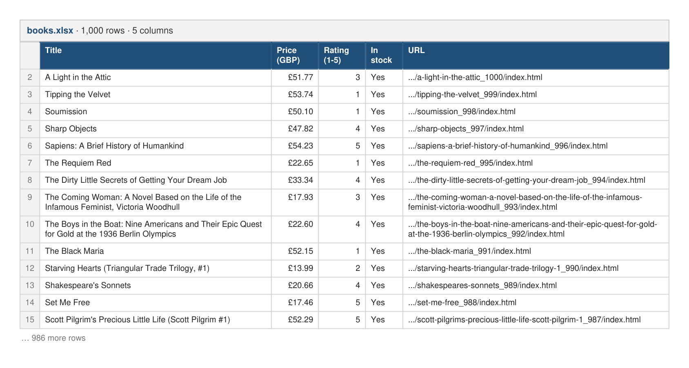

# Libros a Excel: web scraping con paginación

[English](README.md) · **Español**

Recoge los 1.000 libros de [books.toscrape.com](https://books.toscrape.com), una web hecha para practicar scraping, recorriendo sus 50 páginas, y los guarda en un Excel con formato y en un CSV.

**Resultado:** `books.xlsx` y `books.csv`, 1.000 filas con título, precio (como número, en libras), valoración de 1 a 5, stock y enlace.



## Qué demuestra

- Sigue la paginación hasta la última página.
- Limpia los datos: precios como números y estrellas como valoración de 1 a 5.
- Comprueba su propio resultado: compara el número de filas con el total que muestra la web y cuenta los campos vacíos.
- Hace scraping con educación: lee primero robots.txt y espera 1 segundo entre páginas.

Última ejecución, 19-nov-2026: 1.000 de 1.000 libros, 0 campos vacíos.

## Cómo ejecutarlo

```
pip install -r requirements.txt
python scrape_books.py
```

## Adaptarlo a otra web

Cambia `START_URL` y los selectores CSS de `parse_page()`.
