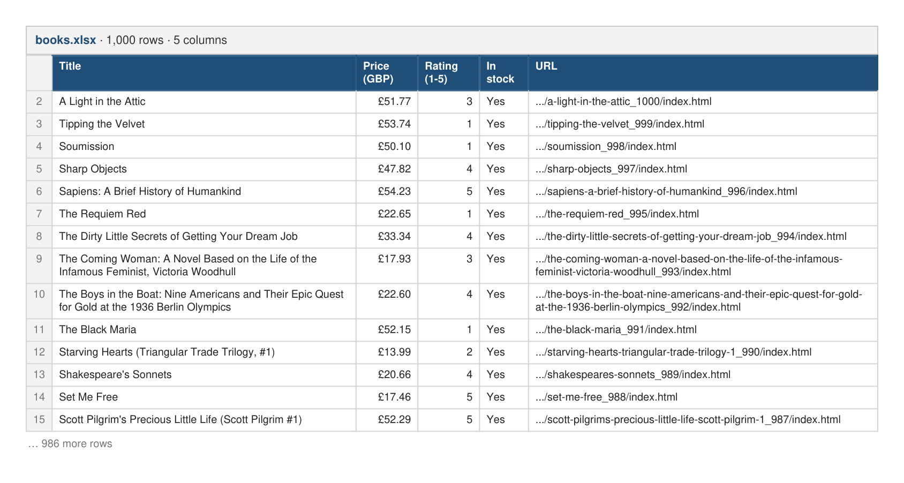

# Books to Excel: web scraping with pagination

Collects all 1,000 books from [books.toscrape.com](https://books.toscrape.com), a website built for scraping practice, across its 50 pages, and saves them to a formatted Excel file and a CSV.

**Output:** `books.xlsx` and `books.csv`, 1,000 rows with title, price (as a number, £ format), rating from 1 to 5, stock and URL.



## What it shows

- Follows the pagination to the last page.
- Cleans the data: prices as numbers, star ratings as 1 to 5.
- Checks its own result: compares the row count with the total the site displays and counts empty fields.
- Scrapes politely: reads robots.txt first and waits 1 second between pages.

Last run, 19 Nov 2026: 1,000 of 1,000 books, 0 empty fields.

## Run it

```
pip install -r requirements.txt
python scrape_books.py
```

## Adapt it to another site

Change `START_URL` and the CSS selectors in `parse_page()`.
