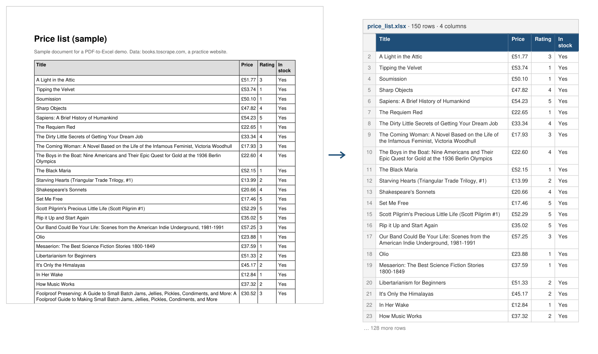

# Tablas de PDF a Excel

[English](README.md) · **Español**

Extrae las tablas de todas las páginas de un PDF y las junta en una sola hoja de Excel limpia.

**Demo:** `sample_price_list.pdf` (4 páginas, 150 filas) se convierte en `price_list.xlsx`.



## Qué demuestra

- Junta en una sola hoja una tabla que ocupa varias páginas, sin repetir las cabeceras.
- Conserva espacios, acentos y decimales, y devuelve las ligaduras tipográficas a letras normales («ff» a «ff»).
- Detecta las columnas de números y las guarda como números de verdad (los precios conservan el £ como formato de celda).
- Comprobado contra los datos originales: 150 de 150 filas idénticas.

## Cómo ejecutarlo

```
pip install -r requirements.txt
python pdf_to_excel.py tu_archivo.pdf [salida.xlsx]
```

Funciona con PDF que tienen texto de verdad (se puede seleccionar). Los PDF escaneados necesitan antes un OCR.

## Sobre el PDF de muestra

Lo genera `make_sample_pdf.py` con los datos que recoge `../books-to-excel` (books.toscrape.com, una web de práctica).
