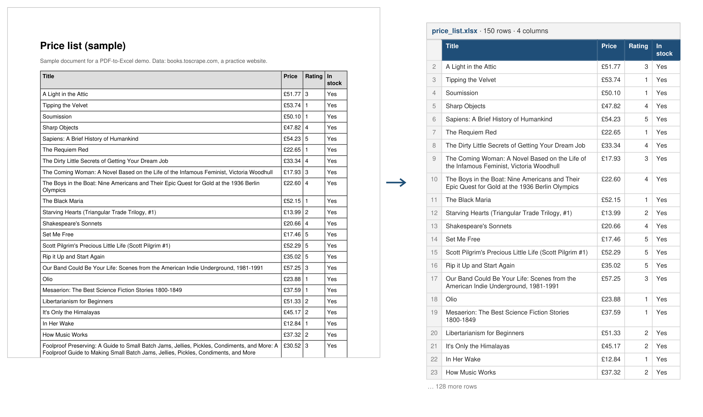

# PDF tables to Excel

Extracts the tables from every page of a PDF into one clean Excel sheet.

**Demo:** `sample_price_list.pdf` (4 pages, 150 rows) becomes `price_list.xlsx`.



## What it shows

- Joins a table that runs across several pages into a single sheet, skipping repeated headers.
- Keeps spaces, accents and decimal points intact, and turns typographic ligatures back into normal letters ("ff" to "ff").
- Detects number columns and stores them as real numbers (prices keep the £ as a cell format).
- Checked against the source data: 150 of 150 rows identical.

## Run it

```
pip install -r requirements.txt
python pdf_to_excel.py your_file.pdf [output.xlsx]
```

It works with PDFs that contain real text (you can select it). Scanned PDFs need OCR first.

## About the sample PDF

`make_sample_pdf.py` generated it from the data collected by `../books-to-excel` (books.toscrape.com, a practice website).
