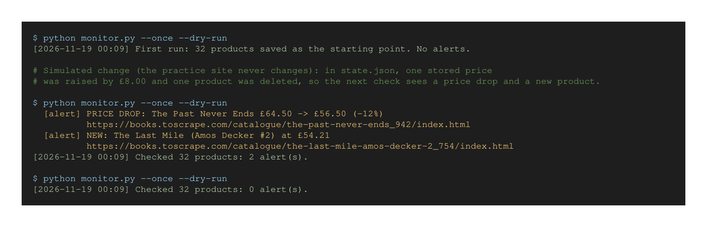

# Monitor de precios: avisos por Telegram o Discord

[English](README.md) · **Español**

Vigila un listado de productos y envía un aviso cuando aparece un producto nuevo, desaparece uno o cambia un precio. La demo vigila la categoría Mystery (32 libros, 2 páginas) de [books.toscrape.com](https://books.toscrape.com), una web hecha para practicar scraping.



## Qué demuestra

- Recuerda la última revisión en `state.json`, así que solo avisa de cambios reales. La primera ejecución fija el punto de partida y no envía nada.
- Cada aviso incluye el precio anterior, el nuevo y el % de cambio.
- Se ejecuta una vez (para cron o el Programador de tareas de Windows) o en bucle, y sigue funcionando después de un error de red.
- `--dry-run` muestra los avisos en pantalla en lugar de enviarlos.

## Demo

`demo_log.txt` muestra tres ejecuciones. La web de práctica nunca cambia, así que antes de la segunda se subió en £8 un precio guardado y se borró un producto de `state.json`. Así se simulan una bajada de precio y un producto nuevo. La tercera no envía avisos porque no ha cambiado nada.

## Cómo ejecutarlo

```
pip install -r requirements.txt
python monitor.py --once --dry-run
```

## Enviar avisos de verdad

Telegram: crea un bot con @BotFather, ábrelo y pulsa Iniciar, y ejecuta `python telegram_setup.py`. Te pide el token (nunca lo muestra en pantalla), encuentra tu chat id y te envía un aviso de prueba. Después define:

```
# Linux / macOS
export TELEGRAM_TOKEN="123456:ABC..."
export TELEGRAM_CHAT_ID="123456789"
# Windows PowerShell
$env:TELEGRAM_TOKEN="123456:ABC..."
$env:TELEGRAM_CHAT_ID="123456789"
```

Discord: en los ajustes del canal, Integraciones y Webhooks, copia la URL y define `DISCORD_WEBHOOK` de la misma forma.

Después ejecuta `python monitor.py --every 600` para revisar cada 10 minutos.
