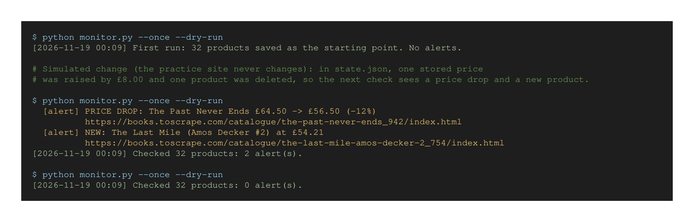

# Price alert monitor: Telegram or Discord

Watches a product listing and sends an alert when a product is new, is removed or changes price. The demo watches the Mystery category (32 books, 2 pages) of [books.toscrape.com](https://books.toscrape.com), a website built for scraping practice.



## What it shows

- Remembers the last check in `state.json`, so it only alerts on real changes. The first run sets the starting point and sends nothing.
- Each alert gives the old and new price and the % change.
- Runs once (for cron or Windows Task Scheduler) or in a loop, and keeps going after a network error.
- `--dry-run` prints the alerts instead of sending them.

## Demo

`demo_log.txt` shows three runs. The practice site never changes, so before the second run one stored price was raised by £8 and one product was deleted from `state.json`. That simulates a price drop and a new product. The third run sends no alerts because nothing changed.

## Run it

```
pip install -r requirements.txt
python monitor.py --once --dry-run
```

## Send real alerts

Telegram: create a bot with @BotFather, open it and press Start, then run `python telegram_setup.py`. It asks for the token (hidden), finds your chat id and sends a test alert. Then set:

```
# Linux / macOS
export TELEGRAM_TOKEN="123456:ABC..."
export TELEGRAM_CHAT_ID="123456789"
# Windows PowerShell
$env:TELEGRAM_TOKEN="123456:ABC..."
$env:TELEGRAM_CHAT_ID="123456789"
```

Discord: channel settings, Integrations, Webhooks, copy the URL and set `DISCORD_WEBHOOK` the same way.

Then run `python monitor.py --every 600` to check every 10 minutes.
